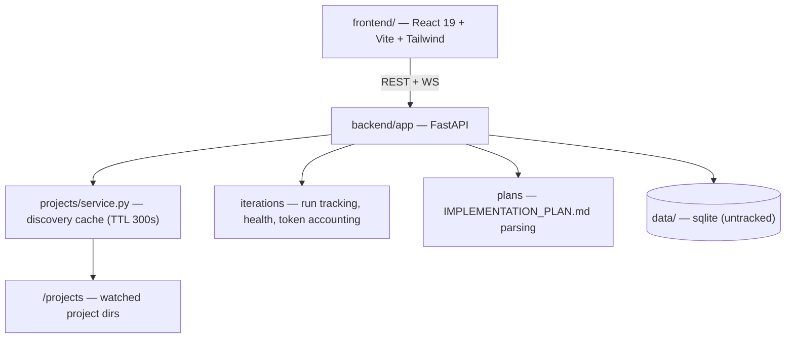

# ralph-dashboard

> **Watch your Ralph agent loops live — charts, iterations, plans, logs, and full process control from the browser.**

<div align="right">

[](#license--security)
[](backend/requirements.txt)
[](frontend/package.json)
[](backend/requirements.txt)
[](https://github.com/Endogen/ralph-dashboard)

</div>

A real-time web UI for monitoring, controlling, and analyzing [Ralph](https://ghuntley.com/ralph/) AI agent sessions. Ralph is a technique — in its purest form, a bash loop that feeds a prompt to an AI coding tool over and over, building software iteratively. This dashboard lets you watch it happen live: project cards with completion status, iteration health timelines, token usage and cost breakdowns, plan progress parsed from `IMPLEMENTATION_PLAN.md`, and expanded iterations with full ANSI-colored terminal output.

**Why care:** agent loops are black boxes — this makes them glass boxes. One glance tells you which project is stuck, which iteration burned tokens, and exactly what the agent did.

> **toxicwind fork** of [Endogen/ralph-dashboard](https://github.com/Endogen/ralph-dashboard), with yote durability fixes on top of upstream `main` (see [Fork changes](#fork-changes-yote-durability)). The fork keeps its own release cadence — `estate-projects` holds only the supervision contract.

## Features

- **Live project overview** — stats, progress charts, task burndown, token usage breakdown, iteration health timeline
- **Iteration tracking** — sortable table (status, health, duration, tokens, cost, tasks) with expandable full terminal output + ANSI rendering
- **Plan management** — interactive task board with phase progress bars, parsed from `IMPLEMENTATION_PLAN.md`
- **Process control** — start/stop/steer agent sessions from the browser
- **Log streaming** — live log tail per project and per iteration
- **Cost visibility** — token usage and spend per iteration, per project
- **Auth built in** — JWT sessions, credentials file, token-scrubbed gitignore

## Screenshots


*Project overview with live stats, progress charts, task burndown, token usage breakdown, and iteration health timeline.*

<details>
<summary>📊 Dashboard & project list · 📋 Plan board · 🔄 Iteration detail</summary>


*Project cards with completion status, iteration count, token usage, and cost.*


*Interactive task board with phase progress bars.*


*Expanded iteration with full terminal output and ANSI color rendering.*

</details>

## Quick start

```bash
docker compose up --build -d
# open http://127.0.0.1:8420 — health: GET /api/health
```

Or run it bare-metal:

```bash
(cd backend && python -m venv .venv && .venv/bin/pip install -r requirements.txt && .venv/bin/uvicorn app.main:app --port 8420) &
(cd frontend && npm ci && npm run dev)
```

## Architecture



| Path | Owns |
|---|---|
| `backend/app` | FastAPI service: projects, iterations, plans, logs, auth |
| `backend/app/projects/service.py` | project discovery with 300s cache (yote fix) |
| `backend/app/projects/discovery.py` | `os.walk` tree scan, prunes `.archive*` (yote fix) |
| `frontend/src` | React 19 dashboard UI (Vite + Tailwind) |
| `data/` | runtime sqlite + credentials (untracked, never commit) |
| `docs/screenshots/` | UI screenshots used above |

### Fork changes (yote durability)

- Project discovery cache TTL 10s → 300s (`backend/app/projects/service.py`) — the 5s status-reconcile loop was re-walking the whole project tree every other tick and pinning workers at ~75% CPU with zero users connected. Discovery still invalidates explicitly on project register/unregister.
- `os.walk` prunes `.archive*` directory prefixes (`backend/app/projects/discovery.py`) — archive trees are huge and never contain live projects.
- `psutil` added to `backend/requirements.txt`; `*.tsbuildinfo` untracked.
- Token-scrub entries in `.gitignore` (never commit secrets).

## Config

| Variable | Purpose |
|---|---|
| `RALPH_CREDENTIALS_FILE` | path to credentials yaml (default `/data/credentials.yaml`) |
| `RALPH_DB_DIR` | sqlite dir (default `/data`) |
| `RALPH_PROJECT_DIRS` | watched project roots (default `/projects`) |
| `RALPH_JWT_SECRET` | JWT signing secret — **set this, never ship the default** |

## Dev

```bash
(cd backend && .venv/bin/pytest)          # backend tests
(cd frontend && npm run lint && npm run build)  # frontend lint + build
```

Live topology on yote: working copy `/home/toxic/ralph-dashboard` (branch `main`), backend on `127.0.0.1:25194` via pitchfork daemon `estate/ralph-dashboard` (`boot_start=true`, `retry=true`). See [ADOPTION.md](ADOPTION.md) for the canonical-home record.

## License + security

- **License:** none declared — neither upstream ([Endogen/ralph-dashboard](https://github.com/Endogen/ralph-dashboard)) nor this fork ships a LICENSE file. Treat the code as all-rights-reserved until a license lands.
- **Secrets:** configure via environment / `RALPH_CREDENTIALS_FILE`; `data/` is untracked; `.gitignore` scrubs tokens. Never commit `credentials.yaml`.
- **Network:** binds `127.0.0.1` by default (compose maps `127.0.0.1:8420`) — not exposed to LAN unless you change it.
